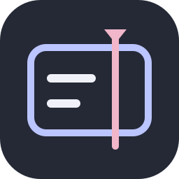
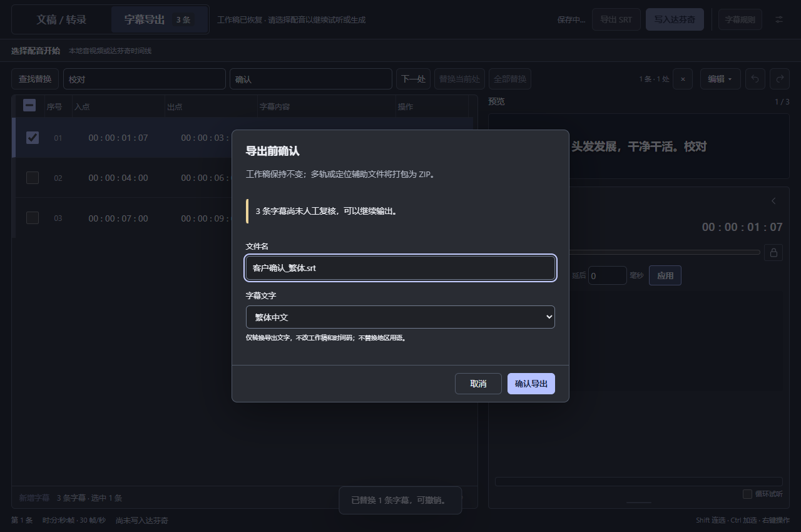

# 句轴 Juzhou · DaVinci Resolve 字幕插件与独立版

**句轴是一款面向 DaVinci Resolve 的 AI 字幕助手，利用本地语音模型完成转录与打轴，将生成或导入的 SRT 字幕写入达芬奇时间线，并支持文稿校对、波形调整及 SRT 导出。** 可独立运行，也可从达芬奇菜单启动。

Windows x64 · 当前版本 **v1.2.0** · 构建 `1.2.0-stable.20261030`。

## 功能

- **字幕写入达芬奇**：导入 SRT → 编辑校对 → 写入原生字幕轨道；也可读取时间线配音生成字幕，保留写入回执供核验与撤销。
- **本地 AI 转录与打轴**：支持千问 Qwen3-ASR、Qwen3-ForcedAligner、Zipformer 和 SenseVoice，多模型切换；有文稿直接对齐，无文稿先转录。
- **文稿整理**：常见文档导入、格式清理、分句、标点规则，原稿保护与红删蓝增对照。
- **字幕校对**：双向编辑、多选、拆分合并、查找替换、撤销重做、波形试听与时间调整。
- **输出交付**：SRT 自定义命名、日期与版本编号、重叠分轨、导出前问题提示、繁体中文导出。

## 下载与开始

提供 Windows 安装版和便携版，可在 [下载页面](https://github.com/Pawaganti/Juzhou-Resolve-Downloads/releases/latest) 获取。

| 下载 | 用法 |
| --- | --- |
| **[Windows 安装版 EXE](https://github.com/Pawaganti/Juzhou-Resolve-Downloads/releases/download/v1.2.0/Juzhou-v1.2.0-windows-x64-setup.exe)** | 双击中文安装向导，提供快捷方式和 Windows 卸载入口；更新保留配置。 |
| **[便携版 ZIP](https://github.com/Pawaganti/Juzhou-Resolve-Downloads/releases/download/v1.2.0/Juzhou-v1.2.0-win32-x64.zip)** | 完整解压，双击 `00-Start.cmd`；附带达芬奇辅助 CMD。 |

1. 选择安装版或便携版，打开句轴。
2. 音频转录前按 [模型配置教程](docs/MODEL_SETUP.zh-CN.md) 下载或关联模型；已有 SRT 无需语音模型。
3. 选择配音 → 转录或文稿打轴 → 校对并导出 SRT／写入达芬奇时间线。

两种运行包均不含模型、个人配置和文稿。API 目前仅保存配置。

[安装、更新与卸载](docs/INSTALL.zh-CN.md) · [模型配置](docs/MODEL_SETUP.zh-CN.md) · [达芬奇接入](docs/RESOLVE_SETUP.zh-CN.md) · [使用说明](docs/USAGE.zh-CN.md) · [兼容性说明](docs/COMPATIBILITY.md)

## 界面

下图为当前构建的**合成演示字幕**，不含个人项目；显示繁体 SRT 导出选项。

## 使用范围

这里提供 Windows x64 运行包、使用说明与模型配置教程，不包含模型权重、个人资料或完整开发源码。首次语音处理需配置模型；已有 SRT 可直接校对。应用为独立窗口，达芬奇菜单负责启动，非原生停靠面板。

API 当前仅保存配置；中文、英文与混排是主要使用场景，其他语言未逐一实测。详见 [兼容性说明](docs/COMPATIBILITY.md)。

同系列：[声匣 SoundBox](https://github.com/Pawaganti/SoundBox-Resolve-Downloads)。
